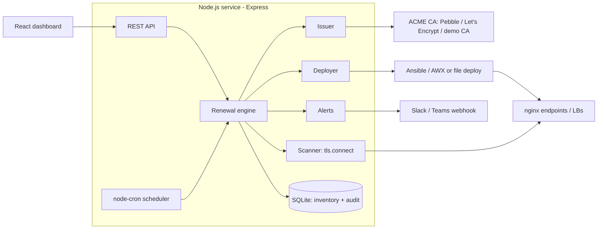

# CertRotator - Demo Document

## 1. Problem (30 sec)
Expired certificates cause outages, and manual renewal across many servers is easy to forget.
CertRotator automates: discover -> renew -> deploy -> verify -> audit.

## 2. Architecture (docs/architecture.svg)

**Design choices**
- Pluggable `Issuer` and `Deployer` - a new CA or target type is one small class.
- Verification re-reads the live endpoint, so "deployed" means "actually serving the new cert".
- Unreachable endpoints are reported, not renewed blindly.
- Key written before cert, atomically (rename), so a server never sees a mismatched pair.
- Audit only logs status *changes* for scans, so the trail stays readable.

## 3. Live demo (5 min)
1. `docker compose up --build`; open http://localhost:8000 - both sites **expiring** (1-day certs).
2. `openssl s_client ... :8443` - note serial/expiry.
3. Within ~1 min (or click *Force renew all*) the audit trail shows `renew_started > issued > deployed > verified`.
4. Re-run `openssl` - new serial, ~90 days; dashboard turns **ok**.
5. `docker compose stop nginx-b`, click *Scan now* - **unreachable** + alert, no blind renewal.
6. Show `npm test` passing (rotation e2e, healthy cert skipped, unreachable handled).

## 4. Likely interview questions
- **Why not certbot cron?** Certbot is per-host; this is a central inventory with verification, audit, alerting and multi-endpoint deploy.
- **Scaling?** Move the cron tick to a queue (BullMQ/Redis) with workers; SQLite -> Postgres. Targets are independent, so it parallelises.
- **HTTP-01 vs DNS-01?** HTTP-01 needs port 80 reachable; DNS-01 supports wildcards and internal hosts via DNS provider APIs (roadmap).
- **Key security?** Keys written 0600, never logged (`no_log` in Ansible); production: Vault, short-lived keys.
- **Failure handling?** Each step audited; failures alert; old cert stays live until the new one is deployed.
- **Limitations (be honest)?** Demo CA isn't publicly trusted; DNS-01, Vault, appliance deployers not built.
